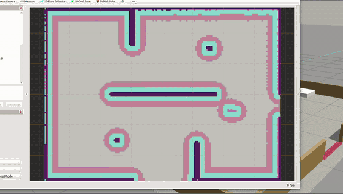
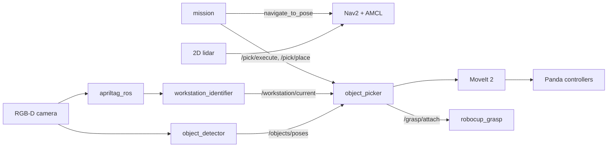
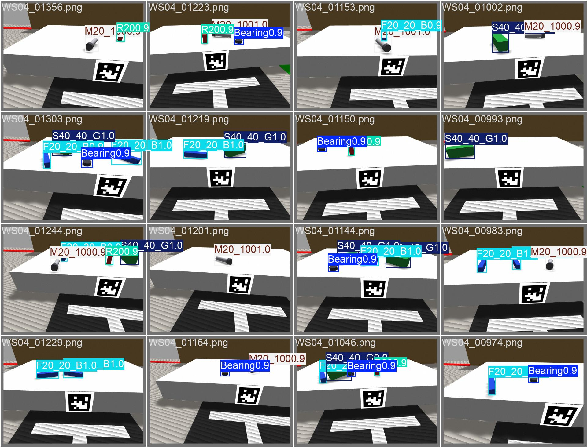

# robocup_at_work

Simulation of a mobile manipulator for the RoboCup@Work league, built on ROS 2 Humble
and Gazebo Classic 11.

The robot starts in the start area, drives to a workstation, detects the objects on
the table, picks one up, carries it to another workstation, places it, and finishes in
the end area.



One full run at 6x speed: two transport jobs, start to end area. The original
screen recording at real speed is in two parts:
[part 1](robocup_at_work/docs/media/mission_run_part1.webm), [part 2](robocup_at_work/docs/media/mission_run_part2.webm).

## Robot

- Holonomic base, simulated with Gazebo's planar_move plugin (no wheel or roller
  dynamics)
- Franka Panda arm and gripper
- RGB-D camera and 2D lidar

## Pipeline

| Part | What it does |
|---|---|
| Navigation | Nav2 with AMCL on a map built with slam_toolbox |
| Workstation ID | AprilTags (tag36h11) on the front of each table |
| Object detection | YOLOv8n trained on synthetic images from the sim. Position from the table plane, yaw from the depth image |
| Manipulation | MoveIt 2, top-down grasp, stops closing when the fingers stall on the object |
| Grasp | Small Gazebo plugin (`robocup_grasp`) that attaches the object to the hand while it is held |
| Mission | Runs the whole task from a list of jobs |

Objects: F20_20_B, S40_40_G, M20_100, R20, Bearing.



## Requirements

- Ubuntu 22.04
- ROS 2 Humble
- Gazebo Classic 11

Tested on a laptop with a Ryzen 5 4600H, 8 GB RAM and a GTX 1650 (4 GB). The full
stack runs headless on that; training needs the GPU.

Gazebo Classic reached end of life in January 2025. Moving to Gazebo Sim would mean
replacing planar_move, the camera plugins and the grasp plugin.

```bash
sudo apt install ros-humble-gazebo-ros-pkgs ros-humble-gazebo-ros2-control \
    ros-humble-ros2-controllers ros-humble-moveit \
    ros-humble-moveit-resources-panda-description \
    ros-humble-nav2-bringup ros-humble-slam-toolbox \
    ros-humble-apriltag-ros ros-humble-vision-msgs
```

## Build

```bash
mkdir -p ~/robocup_ws && cd ~/robocup_ws
git clone https://github.com/Akash1682000/robocup_at_work.git src
colcon build --symlink-install
source install/setup.bash
```

The detector runs in a separate virtualenv, since ultralytics needs a newer OpenCV
than the one ROS uses:

```bash
pip install --user virtualenv
python3 -m virtualenv ~/robocup_ws/yolo_env
~/robocup_ws/yolo_env/bin/pip install ultralytics
```

The trained weights are in the repo (`runs/robocup/weights/best.pt`). To train them
again (run from the package folder, `~/robocup_ws/src/robocup_at_work`):

```bash
ros2 launch robocup_at_work robot_gazebo.launch.py gui:=false
python3 scripts/gen_dataset.py --samples 1500
~/robocup_ws/yolo_env/bin/python scripts/train_yolo.py
```

This writes `runs/robocup/weights/best.pt`, which the detector loads by default.
Training uses the GPU; add `--device cpu` if there isn't one.

## Run

One command starts everything and runs the mission:

```bash
~/robocup_ws/src/robocup_at_work/scripts/stack.sh mission
```

Or step by step, start everything including navigation:

```bash
cd ~/robocup_ws/src/robocup_at_work
NAV=1 scripts/stack.sh up
```

Then start the mission:

```bash
ros2 service call /mission/run std_srvs/srv/Trigger
```

Stop everything with `scripts/stack.sh down`. Logs are in `/tmp/robocup_stack/`.

To launch the parts by hand instead:

```bash
ros2 launch robocup_at_work robot_gazebo.launch.py
ros2 launch robocup_at_work perception.launch.py
ros2 launch robocup_at_work moveit.launch.py
ros2 launch robocup_at_work navigation.launch.py
```

The jobs are set with the `jobs` parameter of the `mission` node, as
`source:object:destination`. The default is `WS01:F20_20_B:WS03` and
`WS02:S40_40_G:WS04`.

Single picks can be tested without the mission:

```bash
ros2 param set /object_picker target_class F20_20_B
ros2 service call /pick/execute std_srvs/srv/Trigger
ros2 service call /pick/place std_srvs/srv/Trigger
```

## Results

Every part is checked against Gazebo ground truth with a script in `scripts/`.
The arena has 12 objects spread over 4 workstations. The pick and reach counts are
those 12 objects at their positions in the world, one attempt each.

| Script | Result |
|---|---|
| `verify_tags.py` | all 4 tags detected, hamming 0 |
| `verify_ros_chain.py` | tag poses within 1 mm |
| `verify_detector.py` | position error 8.4 mm worst case, 0 missed |
| `verify_arm.py` | forward kinematics within 0.05 mm |
| `verify_moveit.py` | 12 of 12 objects reachable |
| `verify_base_hold.py` | base drift 0.36 mm/s with the arm loaded |
| `verify_pick.py` | 11 of 12 objects picked |
| `verify_place.py` | 3 of 3 placed upright |

YOLOv8n reaches mAP50 0.995 and mAP50-95 0.906, at about 5 ms per image. Both
the training and validation images (1205 and 295) are rendered in the same
simulation, so these numbers say nothing about real camera images.

Detector output on validation images:



Training curves are in [results.png](robocup_at_work/runs/robocup/results.png). The confusion
matrix, PR curves and the other train and validation batches are in
[runs/robocup](robocup_at_work/runs/robocup).

The full mission has been run 3 times, with all 6 jobs completed. The latest run,
including the start and end areas, took 274 s.

## Known issues

- R20 is picked about 2 out of 3 times. It is light and tips over before the gripper
  detects contact, so it is left out of the default jobs.
- The base turns slower than commanded in Gazebo. Nav2 corrects for it, so it only
  costs time.
- The grasp plugin is a simulation workaround. On a real robot the hold would come
  from the gripper force and finger friction, which would need tuning on hardware.

## Problems solved

- Objects kept slipping out of the gripper. Raising the friction 7x made no
  difference, Gazebo's contacts just don't hold a grasp, so I wrote a small plugin
  that attaches the object to the hand while it is held.
- Picks were missing by about 2 cm because the base was slowly rolling under the
  arm's weight, about 5 mm/s. Wheel joint damping and a faster planar_move update
  brought it down to 0.36 mm/s.
- The gripper used to close to a fixed width, which knocked the light objects over.
  Now it closes in small steps and stops when the fingers stall.

## Layout

```
robocup_at_work/
  robocup_at_work/   nodes: mission, object_picker, object_detector, workstation_identifier
  launch/            gazebo, navigation, perception, moveit, mapping
  config/            nav2, apriltag, controllers, moveit
  urdf/              robot description
  worlds/ maps/      arena and saved map
  models/            objects and tag textures
  scripts/           stack.sh, dataset and training, verify scripts
  docs/media/        demo GIF and videos
robocup_grasp/       Gazebo grasp plugin (C++)
```

## Credits

- Task and object set based on the [RoboCup@Work](https://atwork.robocup.org) league.
  This is a personal project, not an official entry.
- Franka Panda arm model from Franka Emika ([franka_ros](https://github.com/frankaemika/franka_ros),
  Apache 2.0), loaded through MoveIt's `moveit_resources_panda_description`
- [Ultralytics YOLOv8](https://github.com/ultralytics/ultralytics) and
  [apriltag_ros](https://github.com/christianrauch/apriltag_ros)

## License

MIT
